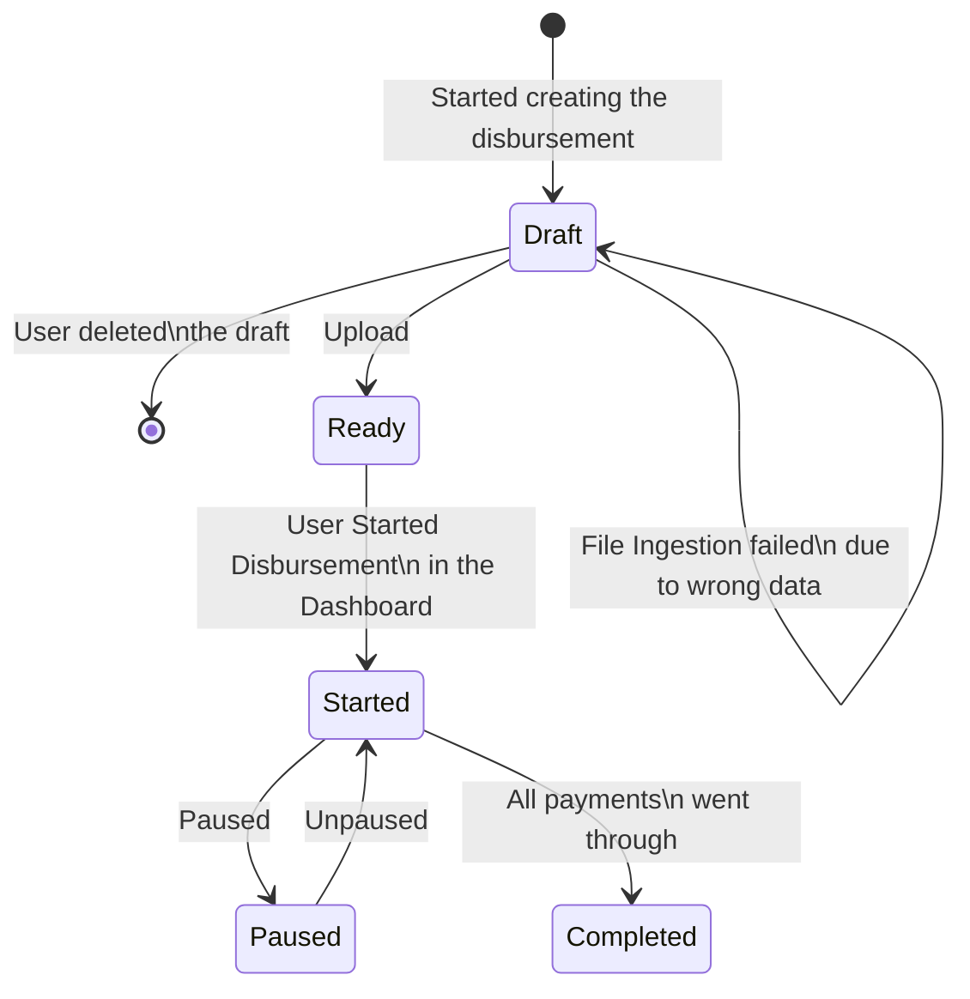
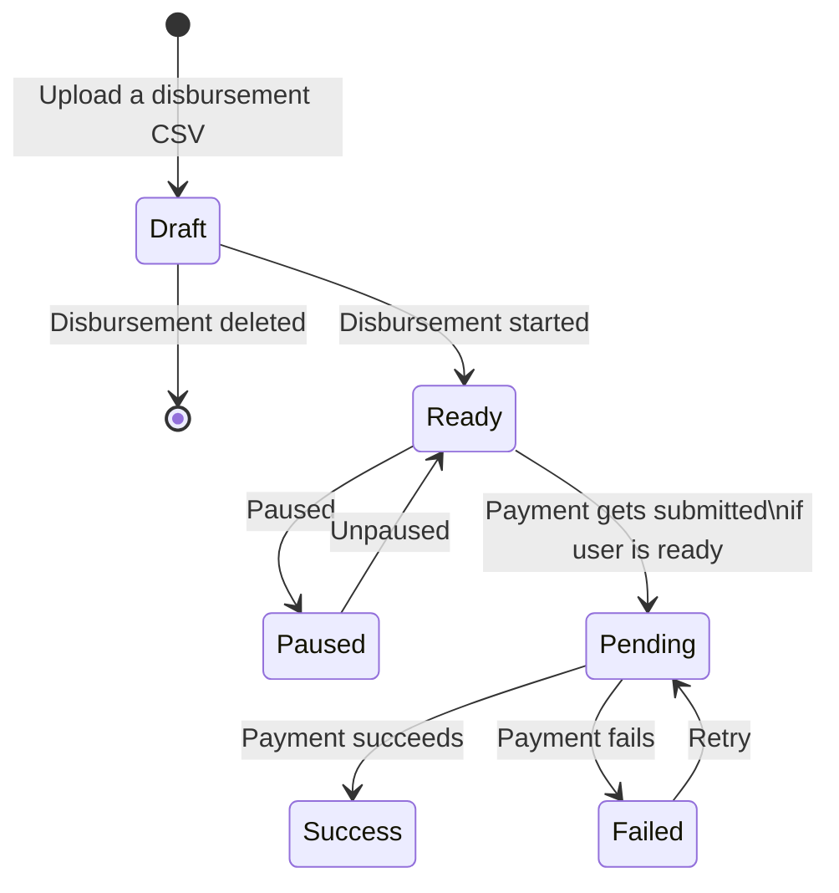
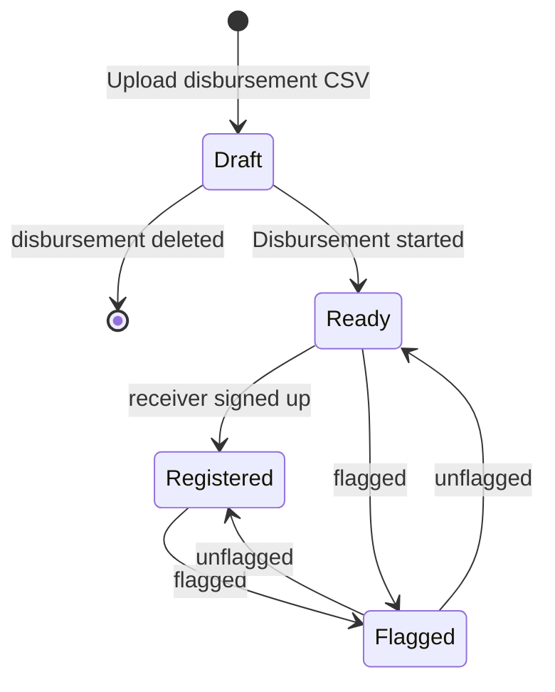
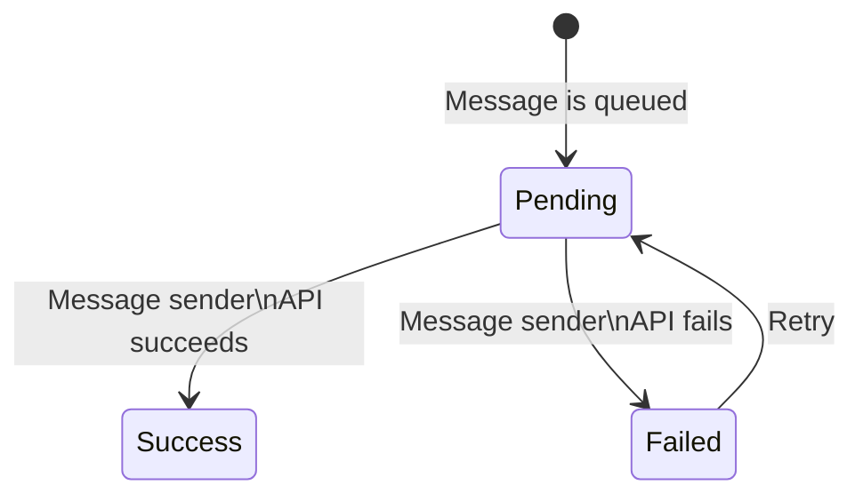

# Stellar Disbursement Platform Backend

[](https://petstore.swagger.io/?url=https://raw.githubusercontent.com/stellar/stellar-docs/refs/heads/main/openapi/stellar-disbursement-platform/bundled.yaml)
[](https://deepwiki.com/stellar/stellar-disbursement-platform-backend)
[](https://developers.stellar.org/docs/platforms/stellar-disbursement-platform)
[](https://github.com/stellar/stellar-disbursement-platform-backend/actions/workflows/docker_image_public_release.yml)
[](https://goreportcard.com/report/github.com/stellar/stellar-disbursement-platform-backend)
[](https://github.com/stellar/stellar-disbursement-platform-backend/blob/main/LICENSE)
[](https://hub.docker.com/r/stellar/stellar-disbursement-platform-backend/tags)
[](https://github.com/stellar/stellar-disbursement-platform-backend/releases/latest)

> Note: you can find a more thorough and user-friendly documentation of this project at [Stellar Docs](https://docs.stellar.org/category/use-the-stellar-disbursement-platform).

## Table of Contents

- [Introduction](#introduction)
- [Install](#install)
- [Quick Start](#quick-start)
- [Architecture](#architecture)
  - [Core](#core)
  - [Transaction Submission Service](#transaction-submission-service)
  - [Database](#database)
- [Disbursement Vault](#disbursement-vault)
- [Wallets](#wallets)
- [Contributors](#contributors)
  - [State Transitions](#state-transitions)

> [!NOTE]
> If you are using version 1.x.x, we highly recommend upgrading to version 2.x.x to benefit from the latest features, routine fixes, and security patches.
> For detailed instructions on how to upgrade, please refer to [the upgrade guide](https://developers.stellar.org/docs/platforms/stellar-disbursement-platform/admin-guide/single-tenant-to-multi-tenant-migration).

## Introduction

The Stellar Disbursement Platform (SDP) enables organizations to disburse bulk payments to recipients using Stellar.

Throughout this documentation, we'll define "users" as members of the organization using the SDP to make payments, while defining "recipients" as those receiving payments.

## Install

Install golang and make sure `$GOPATH/bin` is in your `$PATH`. Then run the following.

``` sh
git clone git@github.com:stellar/stellar-disbursement-platform-backend.git
cd stellar-disbursement-platform-backend
make go-install
stellar-disbursement-platform --help
```

## Quick Start

### Docker Compose

To quickly test the SDP using preconfigured values, use the startup wizard.

```sh
make setup
```

For more information about launching and configuring the SDP, see the [Quick Start Guide](./dev/README.md).

### Helm

To deploy the SDP using Helm, see the [Helm Chart](./helmchart/sdp/README.md).

## Secure Operation Manual

This manual outlines the security measures implemented in the Stellar Disbursement Platform (SDP) to protect the integrity of the platform and its users. By adhering to these guidelines, you can ensure that your use of the SDP is as secure as possible.

Security is a critical aspect of the SDP. The measures outlined in this document are designed to mitigate risks and enhance the security of the platform. Users are strongly encouraged to follow these guidelines to protect their accounts and operations.

### Implementation of reCAPTCHA

Google's reCAPTCHA has been integrated into the SDP to prevent automated attacks and ensure that interactions are performed by humans, not bots.


ReCAPTCHA can be configured at two levels:
1. **Environment level (default)**: Set the `DISABLE_RECAPTCHA` environment variable to `true` to disable for all tenants
2. **Organization level**: Each tenant can override the environment default through the organization settings (via API or UI)

The SDP supports both reCAPTCHA v2 ("I'm not a robot") and reCAPTCHA v3 (invisible, score-based) implementations:

- **reCAPTCHA v2**: Traditional checkbox-based verification
- **reCAPTCHA v3**: Invisible verification that returns a score (0.0 to 1.0) indicating the likelihood of human interaction

#### Configuration

- **CAPTCHA_TYPE**: Specifies the type of CAPTCHA to use. Options: `GOOGLE_RECAPTCHA_V3` or `GOOGLE_RECAPTCHA_V2`
- **RECAPTCHA_SITE_KEY**: The Google reCAPTCHA site key
- **RECAPTCHA_SITE_SECRET_KEY**: The Google reCAPTCHA site secret key
- **RECAPTCHA_V3_MIN_SCORE**: Minimum score threshold for reCAPTCHA v3 (0.0 to 1.0, default: 0.5). Only used when CAPTCHA_TYPE is `GOOGLE_RECAPTCHA_V3`
- **DISABLE_RECAPTCHA**: Set to `true` to disable reCAPTCHA entirely

ReCAPTCHA is enabled by default and can be disabled in the development environment by setting the `DISABLE_RECAPTCHA` environment variable to `true`.

The organization-level setting takes precedence over the environment default when explicitly set. If not set at the organization level, the environment default is used.

**Note:** Disabling reCAPTCHA is supported for pubnet environments but this might reduce security!

### Enforcement of Multi-Factor Authentication

Multi-Factor Authentication (MFA) provides an additional layer of security to user accounts. It is enforced by default on the SDP and it relies on OTPs sent to the account's email.

MFA can be configured at two levels:
1. **Environment level (default)**: Set the `DISABLE_MFA` environment variable to `true` to disable for all tenants
2. **Organization level**: Each tenant can override the environment default through the organization settings (via API or UI)

The organization-level setting takes precedence over the environment default when explicitly set. If not set at the organization level, the environment default is used.

**Note:** Disabling MFA is not recommended for production environments due to security risks.

### Best Practices for Wallet Management

The SDP wallet should be used primarily as a hot wallet with a limited amount of funds to minimize potential losses.

#### Hot and Cold Wallets

- A hot wallet is connected to the internet and allows for quick transactions.
- A cold wallet is offline and used for storing funds securely.
- Learn more about these concepts at [Investopedia](https://www.investopedia.com/hot-wallet-vs-cold-wallet-7098461).

### Distribution of Disbursement Responsibilities

To enhance security, disbursement responsibilities should be distributed among multiple financial controller users.

#### Recommended Configuration

1. **Approval Flow**: Enable the approval flow on the organization page to require two users for the disbursement process. The owner can do that at *Profile > Organization > ... > Edit details > Approval flow > Confirm*.
2. **Financial Controller Role**: Create two users with the *Financial Controller* role on the organization page to enforce separation of duties. The owner can do hat at *Settings > Team Members*.
3. **Owner Account Management**: Use the Owner account solely for user management and organization configuration. Avoid using the Owner account for financial controller tasks to minimize the exposure of that account.

## Architecture


The [SDP Dashboard][sdp-dashboard] components are separate projects that must be installed and configured alongside the services included in this project.

In a future iteration of this project, the Transaction Submission Service (TSS) will also be moved to its own repository to be used as an independent service. At that point, this project will include the services contained in the Core module shown in the diagram above.

### SEP10 and SEP24 Implementation

The SDP now includes native implementations of Stellar Enhancement Proposals SEP10 and SEP24, providing wallet authentication and interactive deposit flows without requiring external Anchor Platform integration.

#### SEP10 Authentication

SEP10 provides a secure way for wallets to authenticate with the SDP using Stellar transactions. The implementation includes:

- **Challenge Generation**: Creates cryptographically secure challenge transactions
- **Transaction Validation**: Validates signed challenge transactions from wallets
- **JWT Token Generation**: Issues JWT tokens for authenticated sessions
- **Multi-tenant Support**: Handles authentication across different tenant domains
- **Client Domain Verification**: Validates client domain signatures for enhanced security

**Endpoints:**
- `GET /auth` - Generate authentication challenge
- `POST /auth` - Validate challenge and receive JWT token

#### SEP24 Interactive Deposit Flow

SEP24 enables interactive deposit flows for wallet registration and payment processing:

- **Interactive Registration**: Guides users through wallet registration process
- **OTP Verification**: Handles one-time password verification for recipients
- **Transaction Status Tracking**: Monitors deposit transaction status
- **Multi-language Support**: Supports multiple languages for the registration UI
- **JWT-based Security**: Uses JWT tokens for secure transaction handling

**Endpoints:**
- `GET /sep24/info` - Get supported assets and capabilities
- `POST /sep24/transactions/deposit/interactive` - Initiate interactive deposit
- `GET /sep24/transactions` - Get transaction status
- `/wallet-registration/start` - Interactive registration UI

#### Configuration

The SEP10/SEP24 implementation can be configured using the following environment variables:

```bash
# SEP10 Configuration
SEP10_SIGNING_PUBLIC_KEY=G...  # Public key for SEP10 signing
SEP10_SIGNING_PRIVATE_KEY=S... # Private key for SEP10 signing

# SEP24 Configuration
SEP24_JWT_SECRET=jwt_secret_... # JWT secret for SEP24 tokens
SEP24_JWT_EXPIRATION_SECONDS=600 # How long SEP24 tokens stay valid, in seconds
```

The SDP serves its own SEP10/SEP24 endpoints and the `stellar.toml` file points to these native endpoints instead of external Anchor Platform URLs.

#### Environment Variables

The following environment variables are required for SEP10/SEP24 functionality:

**Required Variables:**
- `SEP10_SIGNING_PUBLIC_KEY` - Public key for SEP10 challenge signing
- `SEP10_SIGNING_PRIVATE_KEY` - Private key for SEP10 challenge signing
- `SEP24_JWT_SECRET` - JWT secret for SEP24 token signing

**Optional Variables:**
- `SEP24_JWT_EXPIRATION_SECONDS` - How long SEP24 tokens stay valid, in seconds. Defaults to 600. Minimum 5. Values above 3600 log a warning at startup.
- `BASE_URL` - Base URL for generating SEP endpoint URLs in stellar.toml

**Development Setup:**
The `make_env.sh` script automatically generates SEP10 signing keys and creates the necessary `.env` file with proper configuration for development environments.

### Core

The SDP Core service include several components started using a single command.

```sh
stellar-disbursement-platform serve --help
```

#### Admin API

The Admin API is the component responsible for managing tenants of the SDP. It runs by default on port 8003 and is used to provision new tenants and manage existing tenants.

#### Dashboard API

The Dashboard API is the component responsible for enabling clients to interact with the SDP. The primary client is the [SDP Dashboard][sdp-dashboard], but other clients can use the API as well.

##### Metrics

The Dashboard API component is also responsible for exporting system and application metrics. We only have support for `Prometheus` at the moment, but we can add new monitors clients in the future.

#### Message Service

The Message Service sends messages to users and recipients for the following reasons:

- Informing recipients they have an incoming disbursement and need to register
- Providing one-time passcodes (OTPs) to recipients
- Sending emails to users during account creation and account recovery flows

Note that the Message Service requires that both SMS and email services are configured. For emails, AWS SES and Twilio Sendgrid are supported. For SMS messages to recipients, Twilio SMS, Twilio WhatsAPP and AWS SNS are supported.

If you're using the `AWS_EMAIL` or `TWILIO_EMAIL` sender types, you'll need to verify the email address you're using to send emails in order to prevent it from being flagged by email firewalls. You can do that by following the instructions in [this link for AWS SES](https://docs.aws.amazon.com/ses/latest/dg/email-authentication-methods.html) or [this link for Twilio Sendgrid](https://www.twilio.com/docs/sendgrid/glossary/sender-authentication).

##### Configuring Twilio WhatsApp

Configuring Twilio WhatsApp requires additional steps beyond the standard Twilio SMS setup.

**Prerequisites:**
1. Set up a Twilio WhatsApp Business Profile and complete the approval process
2. Create message templates in the Twilio Console for each type of message you plan to send
3. Wait for template approval before using them in production

**Message Templates Setup:**

You must create the following message templates in your Twilio Console and obtain their Template SIDs.

1. **Receiver Invitation Template** (`TWILIO_WHATSAPP_RECEIVER_INVITATION_TEMPLATE_SID`)
   - **Purpose**: Notify recipients about incoming disbursements
   - **Variables**: `{{1}}` = Organization Name, `{{2}}` = Registration Link
   - **Example**: "You have a payment waiting for you from the {{1}}. Click {{2}} to register."

2. **Receiver OTP Template** (`TWILIO_WHATSAPP_RECEIVER_OTP_TEMPLATE_SID`)
   - **Purpose**: Send one-time passwords to recipients during wallet registration
   - **Variables**: `{{1}}` = OTP Code, `{{2}}` = Organization Name
   - **Example**: "{{1}} is your {{2}} verification code."

**Configuration:**

Set the following environment variables:

```sh
SMS_SENDER_TYPE=TWILIO_WHATSAPP
TWILIO_ACCOUNT_SID=your_twilio_account_sid
TWILIO_AUTH_TOKEN=your_twilio_auth_token
TWILIO_WHATSAPP_FROM_NUMBER=whatsapp:+1234567890
TWILIO_WHATSAPP_RECEIVER_INVITATION_TEMPLATE_SID=HXxxxxxxxxxxxxxxxxxxxxxxxxxxxxxxxx
TWILIO_WHATSAPP_RECEIVER_OTP_TEMPLATE_SID=HXxxxxxxxxxxxxxxxxxxxxxxxxxxxxxxxx
```

**Important Notes:**
- The `TWILIO_WHATSAPP_FROM_NUMBER` must include the `whatsapp:` prefix and use your approved Twilio WhatsApp number
- Template SIDs are obtained from the Twilio Console after template creation and approval
- WhatsApp requires pre-approved message templates for all business-initiated conversations
- Template variables are automatically populated by the SDP based on the message type
- All templates must be approved by WhatsApp before they can be used in production
- For detailed setup instructions, refer to the [Twilio WhatsApp API documentation](https://www.twilio.com/docs/whatsapp/api)

#### Wallet Registration UI

The Wallet Registration UI is also hosted by the Core server, and enables recipients to confirm their phone number and other information used to verify their identity. Once recipients have registered through this UI, the Transaction Submission Server (TSS) immediately makes the payment to the recipients registered Stellar account.

#### SEP10/SEP24 Endpoints

The Core service now includes native implementations of SEP10 and SEP24 protocols:

- **SEP10 Authentication**: Provides secure wallet authentication using Stellar transactions
- **SEP24 Interactive Deposits**: Handles interactive deposit flows for wallet registration
- **Stellar.toml Generation**: Dynamically generates stellar.toml files with appropriate SEP endpoints
- **Multi-tenant Support**: Supports SEP10/SEP24 across different tenant domains
- **JWT Token Management**: Handles authentication tokens for secure API access

### Transaction Submission Service

Refer to documentation [here](/internal/transactionsubmission/README.md).

#### Core + TSS Integration

Currently, Core and Transaction Submission Service (TSS) interact at the database layer, sharing the `submitter_transactions` table to read and write state. The interaction is as follows:

1. Core inserts rows into the `submitter_transactions` table, queuing payments
2. The TSS polls the `submitter_transactions` table, detecting payments
3. For each payment detected, the TSS creates and submits a transaction to the Stellar network, monitoring its state until it is confirmed to have been included in a ledger or failed with a nonrecoverable error
4. Core's Dashboard API reads from the `submitter_transactions` table on demand to fetch the state of each payment

In future iterations of the project, the Transaction Submission Service will provide an API for clients such as the SDP to use for queuing and polling the state of transactions.

### Database

To manage the migrations of the database, use the `db` subcommand.

####

```sh
stellar-disbursement-platform db --help
```

#### Admin Tables

**Migration CMD**

```sh
stellar-disbursement-platform db admin migrate up
```

The tables below are used to manage tenants and their configurations.


#### Core Tables

**Migration CMD**

The following command will migrate the tables used by the Core service for all tenants.

```sh
stellar-disbursement-platform db auth migrate up --all
stellar-disbursement-platform db sdp migrate up --all
```

It is also possible to migrate the tables for a specific tenant by using the `--tenant-id` flag.

```sh
stellar-disbursement-platform db auth migrate up --tenant-id=tenant_id
stellar-disbursement-platform db sdp migrate up --tenant-id=tenant_id
```

The tables below are used to facilitate disbursements.


The tables below are used to manage user roles and organizational information.


#### TSS Tables

**Migration CMD**

```sh
stellar-disbursement-platform db tss migrate up
```

The tables below are shared by the transaction submission service and core service.


Note that the `submitter_transactions` table is used by the TSS and will be managed by the service when moved to its own project.

### Background jobs
The SDP uses Background jobs to handle asynchronous tasks.

**1. Jobs**

> [!NOTE]
> Certain jobs are not listed here because they cannot be configured and are necessary to the functioning of the SDP.

* `send_receiver_wallets_invitation_job`: This job is used to send disbursement invites to recipients. Its interval is configured through the `SCHEDULER_RECEIVER_INVITATION_JOB_SECONDS` environment variable.
* `payment_to_submitter_job`: This job is used to submit payments from Core to the TSS. Its interval is configured through the `SCHEDULER_PAYMENT_JOB_SECONDS` environment variable.
* `payment_from_submitter_job`: This job is used to notify Core that a payment has been completed. Its interval is configured through the `SCHEDULER_PAYMENT_JOB_SECONDS` environment variable.
* `patch_anchor_platform_transactions_completion`: This job is used to patch transactions in Anchor Platform once payments reach the final state 'SUCCESS' or 'FAILED'. Its interval is configured through the `SCHEDULER_PAYMENT_JOB_SECONDS` environment variable.
* `vault_event_indexer_job`: Indexes the disbursement vault contract's events into each tenant's schema. Registered only when `ENABLE_VAULT=true`; its interval is configured through `VAULT_INDEXER_INTERVAL_SECONDS`. See [Disbursement Vault](#disbursement-vault).

**2. Configuration**

The following environment variables can be used to configure the intervals of the jobs listed above.

```sh
  SCHEDULER_RECEIVER_INVITATION_JOB_SECONDS: # interval in seconds
  SCHEDULER_PAYMENT_JOB_SECONDS: # interval in seconds
```

>[!NOTE]
>Prior to version 3.7.0, background jobs were configured using ENABLE_SCHEDULER=true and EVENT_BROKER_TYPE=NONE.
>This configuration has been deprecated in favor of using EVENT_BROKER_TYPE=SCHEDULER.

### Database connection pool

Tune the per-tenant PostgreSQL connection pool with env vars (defaults shown):

```sh
# Maximum open connections per pool (default: 20)
DB_MAX_OPEN_CONNS=20
# Maximum idle connections retained (default: 2)
DB_MAX_IDLE_CONNS=2
# Close idle connections after N seconds (default: 10 seconds)
DB_CONN_MAX_IDLE_TIME_SECONDS=10
# Recycle connections after N seconds (default: 300 = 5 minutes)
DB_CONN_MAX_LIFETIME_SECONDS=300
```

These settings help prevent idle connection buildup across multi-tenant scheduler cycles, especially on constrained databases.

## Disbursement Vault

Optional integration with the Soroban [`disbursement-vault`](https://github.com/vaultdr0p/contract)
contract: an admin funds a vault with a token, registers recipients with
amounts, each recipient claims their own allocation, and the admin can cancel
unclaimed allocations after a deadline and reclaim the funds.

**Disabled by default.** With `ENABLE_VAULT` unset, the vault routes are not
registered, the indexer job is not scheduled, no RPC calls are made, and no
code path touches the vault tables. The migration still runs, because
migrations are not feature-flagged in SDP and four unused tables are harmless.

Design and rationale: [`docs/VAULT_DESIGN.md`](docs/VAULT_DESIGN.md), which
includes the full OpenAPI 3.1 spec.

### What the backend does, and does not, do

The contract requires the **vault admin's Stellar signature** for `fund`,
`register`, `cancel` and `withdraw`. SDP never holds that key, so it is
deliberately **not** a transaction signer for vault operations. It has three
jobs:

1. **Index** the contract's events into per-tenant Postgres tables.
2. **Serve** that state over the Dashboard API, under existing auth and tenancy.
3. **Build** unsigned, pre-simulated transaction envelopes. The browser signs
   with a wallet and submits; the backend only ever sees XDR.

There is no code path on which SDP could sign a vault operation, because it
never receives a vault signing key. `claim` envelopes are not offered at all:
a claim is authorised by the recipient, not the admin.

### Configuration

| Variable | CLI flag | Default | Notes |
|---|---|---|---|
| `ENABLE_VAULT` | `--enable-vault` | `false` | Master switch |
| `VAULT_CONTRACT_ID` | `--vault-contract-id` | *(empty)* | **Required when enabled**; startup fails fast otherwise. A public contract address, not a secret |
| `VAULT_INDEXER_INTERVAL_SECONDS` | `--vault-indexer-interval-seconds` | `10` | Validated against the minimum job interval |
| `VAULT_INDEX_FROM_LEDGER` | `--vault-index-from-ledger` | `0` (auto) | Pin a bootstrap ledger. `0` starts at the oldest ledger RPC still serves events for |

Enabling the vault requires `RPC_URL`, since the indexer and the transaction
builder both need Stellar RPC. RPC credentials reuse the existing
`RPC_REQUEST_AUTH_HEADER_KEY` / `RPC_REQUEST_AUTH_HEADER_VALUE` settings. **No
new secret is introduced.**

```sh
ENABLE_VAULT=true
VAULT_CONTRACT_ID=CB5HTYC4GZW67ET23SACDCWCCDQ3AKU4TYX7SAUQJSKS6LLQLYA4HG53
VAULT_INDEXER_INTERVAL_SECONDS=10
RPC_URL=https://soroban-testnet.stellar.org
```

### Endpoints

All routes are on the Dashboard API (port 8000), tenant-resolved from the
request subdomain, and authenticated with the existing dashboard session
token. Amounts are **decimal strings** everywhere — they are `i128` stroops,
which exceed both `int64` and IEEE-754 double precision, so parse them with
`BigInt`, never `Number`.

| Method | Path | Roles | Description |
|---|---|---|---|
| `GET` | `/vault/{contract_id}` | owner, financial_controller, business, initiator, approver | Overview: admin, token, deadline, balances, `available`, indexer health |
| `GET` | `/vault/{contract_id}/allocations` | *same* | Allocations with claim status. Filters: `status`, `recipient`. Paginated |
| `GET` | `/vault/{contract_id}/allocations/{recipient}` | *same* | One recipient's allocation |
| `GET` | `/vault/{contract_id}/events` | *same* | Indexed event history, newest first. Filters: `event_type`, `address`. Paginated |
| `GET` | `/vault/{contract_id}/indexer` | *same* | Indexer health on its own |
| `POST` | `/vault/{contract_id}/transactions` | owner, financial_controller | Build an unsigned, simulated envelope for `fund`, `register`, `cancel` or `withdraw` |
| `POST` | `/vault/{contract_id}/resync` | owner | Rewind the indexer cursor and replay |

API keys additionally need the `read:vault` or `write:vault` permission
(`read:all` / `write:all` also match).

Every list response carries an `indexer` object alongside `data` and
`pagination`, so a dashboard can show a staleness or degraded banner without a
second request. A contract id that is not the tenant's configured vault
returns **404**, as does every route when `ENABLE_VAULT` is off.

A simulation failure is returned as **400** carrying the contract's own typed
error, so an operation the contract would reject is reported before the user is
asked to sign:

```json
{
  "error": "The vault does not hold enough unallocated funds for this operation.",
  "extras": { "contract_error_code": 9, "contract_error": "InsufficientFunds" }
}
```

### Monitoring the indexer

Two gauges are exported, labelled by `tenant_name` and `contract_id`:

| Metric | Meaning |
|---|---|
| `sdp_vault_indexer_lag_ledgers` | Ledgers between the chain tip and the last ledger indexed |
| `sdp_vault_indexer_degraded` | `1` when the vault has a known, unrecoverable gap in its event history |

**Alert on lag.** Soroban RPC retains contract events for a bounded window —
measured against `soroban-testnet.stellar.org` as **120,960 ledgers**
(120,959 observed between `oldestLedger` and `latestLedger` at a 5.00s average
close time, exactly 7.00 days, matching RPC's `EVENT_LEDGER_RETENTION_WINDOW`
default). Beyond that window, events cannot be fetched from RPC at all.

The contract exposes `get_allocation(address)` but **no way to enumerate
recipients**, so the event log is the only source of the recipient set. If the
indexer falls behind the retention window, the identity of recipients
registered during the gap is **permanently unrecoverable** — no retry or
resync can reconstruct it. On-chain funds are never at risk and any known
recipient can still claim, but SDP's list may be incomplete.

The backend warns at **half** the window (60,480 ledgers, ~3.5 days of
headroom) in the logs, and errors past the window itself. An equivalent
Prometheus rule:

```yaml
groups:
  - name: sdp-vault
    rules:
      - alert: SDPVaultIndexerLagging
        # Half the RPC event retention window: ~3.5 days of headroom left.
        expr: sdp_vault_indexer_lag_ledgers > 60480
        for: 15m
        labels: { severity: warning }
        annotations:
          summary: "Vault indexer for {{ $labels.contract_id }} is more than half the RPC retention window behind"

      - alert: SDPVaultIndexerLosingEvents
        # Past the window: events are aging out unread, right now.
        expr: sdp_vault_indexer_lag_ledgers > 120960
        for: 5m
        labels: { severity: critical }
        annotations:
          summary: "Vault indexer for {{ $labels.contract_id }} is beyond the RPC retention window; recipient registrations are being lost"

      - alert: SDPVaultIndexerDegraded
        # Independent of lag: a vault can be caught up and still have an
        # unrecoverable gap from an earlier outage.
        expr: sdp_vault_indexer_degraded == 1
        labels: { severity: warning }
        annotations:
          summary: "Vault {{ $labels.contract_id }} has an unrecoverable gap in its indexed event history"
```

If a gap does occur the indexer marks the vault `degraded` with the gap bounds
and keeps serving known allocations, rather than presenting a partial list as
if it were whole. `vault_events` is append-only and never pruned, so SDP's own
history outlives RPC's.

## Wallets

Please check the [Making Your Wallet SDP-Ready](https://docs.stellar.org/stellar-disbursement-platform/making-your-wallet-sdp-ready) section of the Stellar Docs for more information on how to integrate your wallet with the SDP.

## Contributors

This section is a work-in-progress.

### State Transitions

The state transitions of a disbursement, payment, message, and wallet (i.e. recipient Stellar account) are described below.

#### Disbursements



#### Payments



#### Recipient Wallets



#### Messages



[sdp-dashboard]: https://github.com/stellar/stellar-disbursement-platform-frontend
